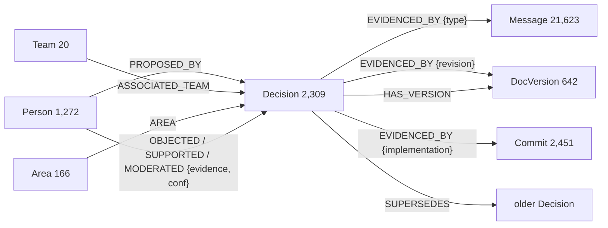

# Decision Cortex — a company brain over `rust-lang/rfcs`

**Graph Hacks (WeMakeDevs × FalkorDB) · Track 3 · Oct 15–18, 2026 · Techa (solo)**

Enterprise knowledge tools retrieve documents; they don't model **decisions** —
what was decided, by whom, over what objection, superseded by what. Decision
Cortex is an open, graph-native, citation-first company brain built on the
hardest test case available: **rust-lang/rfcs**, an organization whose decisions
are all public and all disputed. **2,309 real decision records, 21,623 debate
comments, 3,552 commits** — unified in **FalkorDB** (the primary store; there is
no Postgres and no in-memory side channel), where every `Decision` node hangs
off its evidence by typed provenance edges.

Three claims, each demonstrated live:

1. **Provenance by construction.** Answers are synthesized from graph evidence;
   every sentence carries citation chips that open the exact source — the RFC,
   the GitHub comment, the commit — not a references list bolted on afterwards.
2. **The agent can prove a negative.** "There is no record we ever decided
   that" is a first-class answer: the `NoRecordCard` shows the receipts (N
   nodes searched, M evidence chains, 0 matches) plus the real proposals that
   *came close*. No vector-pile RAG stack can honestly claim this.
3. **Impact analysis is a traversal, not a search.** "What touches async
   trails?" is a bounded multi-hop FalkorDB walk, rendered live by the Impact
   Explorer; the Timeline shows the real `SUPERSEDES` chains.

Answers are checked twice before a judge reads them: a per-sentence **System-1
claim gate** maps each sentence to the evidence supporting it (uncited
sentences are flagged; uncited answers abstain), and a **local HHEM-2.1-Open
cross-encoder** scores every sentence against its cited evidence text for a
RAGAS-style faithfulness badge — `faithfulness 0.86 · 6/7 claims supported` —
after the stream completes, on CPU, at zero API cost.

---

## Run it

```bash
cp infra/.env.example infra/.env        # set OPENROUTER_API_KEY (one key, $10 spend cap)
docker compose -f infra/docker-compose.yml up -d --build
curl http://localhost:8080/healthz      # -> {"status":"ok","seeded":true}
```

The `api` container **seeds FalkorDB from the committed snapshot on boot** —
28k nodes in ~7s, no GitHub quota, no extraction tokens. The four scripted
demo buttons replay from cache, so **judges pay ≈ $0 to replay the demo**; the
decision ledger (footer, live) shows every call's model, confidence, latency,
cost, and escalation flag. `SPEND_CAP_USD=10` is enforced in `api/llm.py`
before any HTTP request.

Automated CI makes **zero LLM calls** (the key is hard-emptied; tests that
need the real API carry the `live` marker and run only via the owner-dispatched
`eval-run` workflow).

## Architecture

```
Snapshot (committed JSONL: rfcs, pr-comments, commits — pinned 2026-10-14)
   │  ingest/: idempotent MERGE-on-id loads via GraphRAG-SDK v1.1.0 storage layer
   ▼
FalkorDB 6.x — decisions, provenance, supersession (schema below)
   ▲                                   │
   │ multi-hop reads                   │ exports (Markdown report / JSON dump)
   ▼                                   ▼
Agent core (FastAPI):               React + Vite SPA (hand-rolled SSE client,
  S1 decide(): router · claim gate   AG-UI event schema, tool→component registry)
             · sufficiency stop
  S2 reason(): sentence-by-sentence synthesis
  schema-grounded prompts + local HHEM faithfulness + decision ledger
```

The graph shapes agent behavior; it is never garnish:

- the **router** classifies 1-of-4 (fact · decision-provenance · impact ·
  out-of-graph) and `out-of-graph` short-circuits to abstention;
- **retrieval** seeds from a FalkorDB full-text index over `Decision.title`
  (plus a vector index when embeddings are configured), then expands one
  bounded hop at a time across the schema's relations, asking S1 after each
  round whether the evidence **suffices** — an early stop is a ledger row;
- **synthesis** is grounded in the *real text* behind each evidence node
  (bounded prefixes from the committed snapshot: comment bodies, RFC markdown,
  commit messages), not permalinks;
- the **claim gate** matches each answer sentence against that grounded
  evidence with a typed `decide()` call per sentence.

S2 runs only for synthesis, impact narratives, and no-record verdicts — three
typed S1 `decide()` calls per answer carry the economics, and the ledger shows
them live.

## Graph schema (FalkorDB)

MADR-4.0.0-informed, GitHub-identity-canonical (`docs/graph-schema-notes.md`
records every derivation decision):

```cypher
(:Decision {rfc, title, status, proposed_on, decided_on, madr_link})
(:Person {handle}) (:Team {name}) (:Area {name}) (:Concept {key})
(:DocVersion {sha, content_ref}) (:Message {comment_id, author, ts, text_ref, truncated})
(:Commit {sha, ts, message})

(:Decision)-[:PROPOSED_BY|ASSOCIATED_TEAM|ABOUT|AREA|HAS_VERSION]->(…)
(:Decision)-[:EVIDENCED_BY {type: discussion|revision|implementation}]->(…)
(:Person)-[:OBJECTED|SUPPORTED|MODERATED {evidence, confidence}]->(:Decision)
(:Decision)-[:SUPERSEDES]->(:Decision)
(:Concept)-[:RELATES {strength}]->(:Concept)
```

The graph stores **refs, never bodies** — `text_ref`/`content_ref` deep-link out
to GitHub. Provenance honesty is structural: truncated comment harvests carry
`truncated: true`, low-confidence stances are flagged, never dropped.

## The graph, mapped

**28,483 nodes · 34,642 edges** over the whole rust-lang/rfcs corpus:

| Label / relation | Count | What it is |
|---|---:|---|
| `Decision` | 2,309 | every merged (1,130) / active / rejected RFC as a node |
| `Message` | 21,623 | the debate: PR comments (first 100 per PR, `truncated` flag honest) |
| `Commit` | 2,451 · `DocVersion` 642 | what shipped it, and the revision evidence |
| `Person` 1,272 · `Team` 20 · `Area` 166 | participants and topic structure |
| `PROPOSED_BY` / `ASSOCIATED_TEAM` / `AREA` / `HAS_VERSION` | 2,309 / 1,554 / 1,609 / 642 | decision metadata edges |
| `EVIDENCED_BY {type}` | 25,821 | discussion · revision · implementation provenance |
| `OBJECTED` / `SUPPORTED` / `MODERATED {evidence, confidence}` | 594 / 1,241 / 869 | S1-classified stances, every one jumpable to its comment |
| `SUPERSEDES` | 3 | real supersession chains the Timeline renders |



## The graph doing the work — an unedited production trace

Captured from the live deployment answering *"Which RFC introduced the
`async`/`await` syntax?"* (the stream in the UI renders this as the
show-your-work strip and CypherPeek — the queries below are verbatim):

```
router_classify   -> {"route": "fact", "confidence": 0.99, "escalated": false}
retrieve_evidence -> {"candidate_count": 54, "rounds": 1, "stopped_early": true}

CALL db.idx.vector.queryNodes('Decision','embedding',$k,vecf32($vector)) …   ← vector seed
CALL db.idx.fulltext.queryNodes('Decision',$q) …                             ← fulltext seed
MATCH (d:Decision)-[r]->(n)  WHERE d.id IN $ids AND type(r) IN $rels …       ← multi-hop out
MATCH (n)-[r]->(d:Decision)  WHERE d.id IN $ids AND type(r) IN $rels …       ← multi-hop in

synthesize  -> RFC 2394 introduced the async/await syntax for ergonomic
               asynchronous IO.                       [cited, 1/1 claims]
claim_gate  -> sentence 1/1 cited -> chip: (rfc:2394, "async/await notation…")
```

Nothing here is keyword search dressed up: the question is *typed* by a model
against the router's graph-shaped labels, the seeds come out of FalkorDB's
vector and full-text indexes, evidence is *expanded across the schema's
relations* (and the S1 sufficiency stop — `stopped_early: true` — is a
decide() call that saved the second hop), the answer sentence is *gated*
against the very node the chip opens, and abstention is what happens when any
of that fails to ground.

## Verification set — the honesty backbone

`verification/questions.jsonl` pins **30 gold questions** (each with its known
decision citation) and **10 no-record questions** (each verified absent by a
recorded case-insensitive corpus search, with method and match counts kept in
the file). Two invariants, both enforced offline by `verification/test_questions.py`:

- every gold citation must be a real URL in the snapshot owned by its RFC — a
  drifted citation fails the build;
- questions are never edited to make a metric pass (`AGENTS.md`).

`POST /verification/run` executes the set through the live pipeline and
reports gold accuracy and no-record abstention correctness (owner-dispatched
`eval-run` workflow; it makes real OpenRouter calls). `GET /verification`
serves the file as authored. Live-run numbers land here before submission.

## Faithfulness — real, local, and free

`POST /faithfulness` scores a finished answer's sentences against their cited
evidence text with **HHEM-2.1-Open** (`vectara/hhallucination_evaluation_model`)
loaded locally (CPU, lazy import, `hf-cache` volume). Aggregation is RAGAS at
claim granularity: `faithfulness = supported / claims_total`, uncited and
unresolvable claims counted as unsupported. The badge lands seconds after the
stream — `docs/faithfulness-notes.md` records the polarity sanity check and
every tradeoff.

## The 4-minute story (what the video shows)

1. `0:00` — "600 merged decisions, 21k debate comments, one question box."
2. Trait-objects question → AnswerCard builds sentence-by-sentence, chips fly
   open to the real comments, the faithfulness badge lands.
3. **The negative-proof moment** — "Did Rust ever decide to require attachments
   in `unsafe` code?" → `NoRecordCard` with search receipts, then the
   came-close trail; the Vector-RAG ablation flash shows the same question
   confabulated on chunk embeddings.
4. Impact Explorer on async/await; the Timeline walks the real supersede
   chains and the scripted lifecycle tour.
5. Ledger close-up (System-1 economics), "bring your own corpus" teaser,
   one-command local run.

## Snapshot methodology (committed, replayable, free)

`snapshot/` holds the pinned Oct 14 harvest: 2,309 PR-as-RFC records
(merged/open/closed status), comments capped at 100 per PR with honest
`truncated` flags, per-RFC-file commits. Rate-limit-safe, resumable, de-
duplicated (`snapshot/README.md`). Committed vectors —
`decision-embeddings.jsonl` — are generated once with the embedding key at
event time (`python -m ingest.embeddings`); without them retrieval degrades to
full-text + traversal by design, and the demo still runs.

## What's real / what's evolving

Shipped and tested: the full answer pipeline over live FalkorDB, principled
abstention with receipts, Impact Explorer + Timeline + exports, claim gates,
decision ledger + spend cap, local HHEM faithfulness, scripted scenarios with
≈$0 replay, offline CI (lint + 266 unit tests + compose smoke), seed-on-boot.

Deliberately deferred (recorded, not hidden): stance edges ship as a
one-command build step — `OPENROUTER_API_KEY=<key> python -m ingest.stances`
classifies the debate in cheap `decide()`-model batches under the same
spend-cap ledger and writes `snapshot/stances.jsonl`; the idempotent seed
re-load turns it into confidence-stamped, jumpable
`OBJECTED|SUPPORTED|MODERATED` edges that Timeline and Impact already render.
The committed embeddings artifact is likewise one key-holding command
(`python -m ingest.embeddings`). The MCP read-peephole
(`@falkordb/mcpserver`) is a stretch surface — the web app is the product.

## Bring your own corpus

The schema is MADR-shaped and GitHub-identity-canonical, so an org's ADRs or
RFCs are a pipeline re-run, not a rewrite: point `ingest/` at any repo's PRs
and files; decisions, supersession, and debate come out of the same edges.
An org that *decides* in public — like the Rust-lang project — gets a brain
that remembers what was decided, who objected, and why it changed.

## Citations

MADR 4.0.0 · Graphiti (temporal-field concept) · GraphRAG-SDK v1.1.0
(`grounded_answers_with_abstention` pattern) · Claim-level attribution: ARE
(arXiv:2410.16708), RAGentA (arXiv:2506.16988) · RAGAS + Vectara HHEM-2.1-Open
· FalkorDB 6.x · AG-UI event schema · React Flow · Caddy
